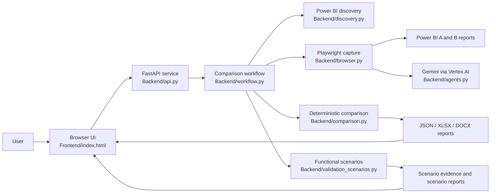
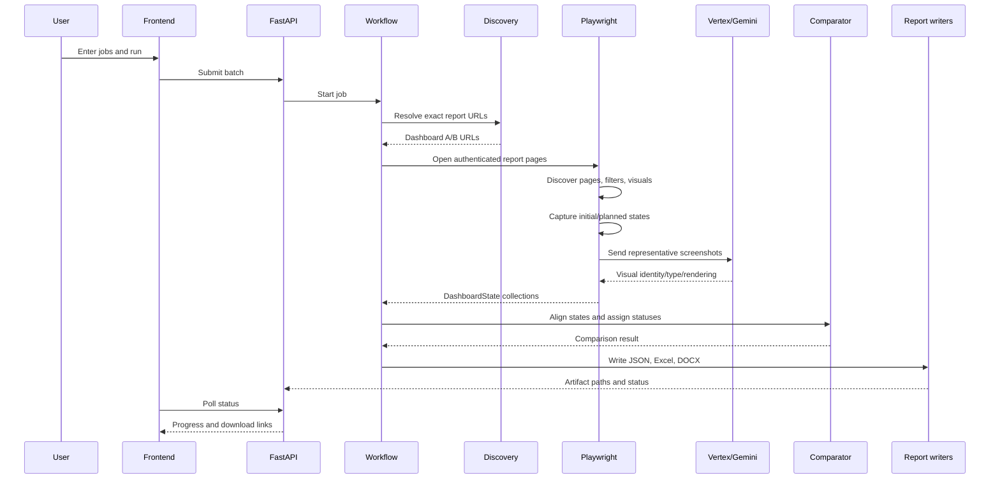

# Power BI Dashboard Comparator Architecture

## 1. Purpose and scope

This project compares two authenticated Power BI reports:

- **Dashboard A**: the Snowflake/Base report supplied by the user.
- **Dashboard B**: the corresponding GCP/Compare report discovered from the
  configured workspace and report naming rules.

The application validates what is visible to a user: report/page identity,
visual presence and rendering, visual type, layout, titles, labels, filters,
table/matrix headers, and selected functional states. It deliberately keeps
visual validation separate from numerical/data-accuracy validation.

The main runtime is a Python FastAPI application with a browser automation
layer built on Playwright, an optional Google ADK/Gemini screenshot-extraction
layer, deterministic Python comparison/reporting, and a small browser
frontend.

## 2. System context



## 3. Repository layout

```text
.
├── Backend/
│   ├── api.py                       FastAPI application and job lifecycle
│   ├── agents.py                    Gemini models, extraction schemas, retries
│   ├── browser.py                   Playwright navigation, DOM capture, exports
│   ├── cli.py                       Command-line entry point
│   ├── comparison.py                State alignment and standard reports
│   ├── config.py                    Vertex AI and environment configuration
│   ├── discovery.py                 Authenticated workspace/report discovery
│   ├── docx_report.py               Standard DOCX report generation
│   ├── json_evidence.py             Atomic JSON read/write helpers
│   ├── models.py                    Dashboard state and domain models
│   ├── scenario_comparison.py       Scenario evidence comparison and DOCX
│   ├── scenario_evidence.py         Evidence paths, manifests, migrations
│   ├── scenario_state_adapter.py    Scenario state/report adaptation
│   ├── standard_elements.py         Standard dashboard elements
│   ├── timing.py                    Structured operation timing events
│   ├── validation_scenarios.py      Functional scenario execution
│   ├── visual_filter_comparison.py  Filter/visual comparison logic
│   ├── visual_filter_report.py      Excel visual/filter report data
│   ├── visual_inventory_report.py   Visual inventory report generation
│   ├── workflow.py                  ADK sequential orchestration
│   └── assets/                      DOCX templates
├── Frontend/
│   ├── index.html                   Job-entry and progress UI
│   └── static/
│       ├── app.js                   Frontend state, API calls, polling
│       └── styles.css               UI styling
├── tests/                           Unit and integration-style tests
├── output/jobs/                     Per-job reports and evidence
├── pyproject.toml                  Package, dependency, and test config
└── setup_and_run.ps1                Local setup/start helper
```

The generated `output/jobs` directory is runtime data, not source code. Each
job has a UUID directory so captures and reports from separate runs do not
overwrite one another.

## 4. Runtime components

### 4.1 FastAPI and job manager

[`Backend/api.py`](./Backend/api.py) serves the frontend and owns the
long-running job lifecycle:

1. Validate submitted jobs and enforce batch limits.
2. Derive or accept Dashboard A and Dashboard B URLs.
3. Create a UUID job directory.
4. Start the asynchronous comparison task.
5. Store progress, stage, errors, and final report paths in memory.
6. Expose status and downloadable report endpoints.

Important endpoints include:

| Endpoint | Responsibility |
|---|---|
| `GET /` | Serve the frontend |
| `GET /api/jobs/{job_id}` | Poll job status/progress |
| `GET /api/jobs/{job_id}/comparison.json` | Download standard JSON |
| `GET /api/jobs/{job_id}/discovery.json` | Download discovery metadata |
| `GET /api/jobs/{job_id}/Dashboard_Comparison.xlsx` | Download Excel report |
| `GET /api/jobs/{job_id}/Dashboard_Comparison.docx` | Download standard DOCX |
| `GET /api/jobs/{job_id}/validation-summary.json` | Download scenario summary |

The API uses the local authenticated Playwright storage state. Credentials
are not accepted in the web form and must not be committed to the repository.

### 4.2 Frontend

[`Frontend/index.html`](./Frontend/index.html), [`Frontend/static/app.js`](./Frontend/static/app.js),
and [`Frontend/static/styles.css`](./Frontend/static/styles.css) implement a
single-page job runner:

- Spreadsheet-style input for up to ten jobs.
- Workspace, semantic model, report, and optional URL fields.
- Input validation before execution.
- Sequential batch progress and per-job status.
- Scenario execution toggle.
- Download links for generated artifacts.

The frontend does not perform Power BI comparison logic. It submits job
metadata, polls the API, and renders server-side progress/results.

### 4.3 Discovery

[`Backend/discovery.py`](./Backend/discovery.py) operates inside the
authenticated Power BI session:

1. Open the tenant-scoped Power BI home URL.
2. Find the exact requested workspace.
3. Find the exact requested report.
4. Verify the resulting report URL.
5. Derive Dashboard B using the configured GCP workspace prefix and report
   suffix when URLs are not supplied directly.

Discovery preserves report/page names and records failures explicitly rather
than silently falling back to a similarly named asset.

### 4.4 Browser capture

[`Backend/browser.py`](./Backend/browser.py) is the largest infrastructure
component. It owns:

- Playwright browser/context/page creation.
- Report navigation and page-tab discovery.
- Readiness and render-state checks.
- Accessible DOM inventory.
- Filter inventory and filter selection.
- Visual container discovery and geometry.
- Screenshot capture.
- Optional Power BI visual-data export.
- Hierarchy/table interaction helpers.
- Per-state capture timing and diagnostics.

The capture pipeline waits for report readiness and visual stability. It
refuses to create a successful partial capture when visuals remain unrendered.
A visible Power BI query/resource error is treated as terminal.

Dashboard A and Dashboard B capture can run concurrently, while state captures
and page captures are bounded by configuration to protect browser and model
capacity.

### 4.5 Gemini/Vertex AI extraction

[`Backend/agents.py`](./Backend/agents.py) provides the AI boundary:

- Pydantic-style extraction models for titles, visual types, bounds, and
  rendering state.
- Screenshot normalization before submission.
- Screenshot visual-name/type/rendering extraction.
- Filter-plan assistance where applicable.
- Retry/backoff for transient Vertex AI failures.
- Output validation and truncation recovery.

AI enriches screenshot/DOM evidence. It does not own final comparison status.
Deterministic Python comparison remains authoritative for `PASS`, `FAIL`, and
`UNVERIFIED` classification.

### 4.6 Workflow orchestration

[`Backend/workflow.py`](./Backend/workflow.py) coordinates a
Google ADK `SequentialAgent` and `ComparisonWorkflowRun`.

The logical stages are:

```text
capture
  -> validate captured states
  -> run functional scenarios, when enabled
  -> compare
  -> write reports
```

During capture, completed page/filter states may be compared incrementally in a
bounded thread pool. The final result is still validated and consolidated
before report generation.

## 5. Standard comparison flow



### State planning

By default, the tool captures the current visible state. With filter-case
execution enabled, it discovers supported slicer options and produces a
one-option-per-filter combination plan. Duplicate initial states are removed.
Unsupported controls are not manipulated speculatively.

### Visual evidence policy

The visual workflow compares:

- Presence/missing visuals.
- Blank, partial, loading, error, or rendered state.
- Visual type and title.
- Position, size, labels, headers, legends, and formatting.
- Page/dashboard layout and filter presentation.

It does not treat different displayed records or metric values as visual
failures; those belong to a separate data-validation concern.

## 6. Functional scenario architecture

The active scenario set is defined in
[`Backend/scenario_comparison.py`](./Backend/scenario_comparison.py):

| ID | Directory | Purpose |
|---|---|---|
| `01` | `01_table_column_header_comparison` | Table/matrix headers plus hierarchy |
| `02` | `02_single_filter_selection` | One supported filter selection |
| `03` | `03_multiple_filter_selection` | Multiple supported filter selections |

Scenario 04 remains a legacy compatibility identifier in
[`Backend/validation_scenarios.py`](./Backend/validation_scenarios.py); it is
not independently registered in the active execution list. Its drill behavior
is integrated into Scenario 01 to prevent duplicate browser actions.

### Scenario 01 hierarchy sequence

For each eligible table/matrix visual, the active flow is sequential:

```text
discover table/matrix
  -> click a DOM value cell
  -> Drill Up until disabled
  -> identify exact "Expand all down one level in the hierarchy"
  -> click/wait until the expansion completion condition is met
  -> capture one expanded-state screenshot
  -> export one expanded-state Excel file
  -> identify exact "Go to the next level in the hierarchy"
  -> click/wait
  -> capture one next-level screenshot
```

The implementation uses direct DOM controls when available:

- `drill-up-level-btn`
- `drill-down-level-grouped-btn`
- `drill-down-level-btn`

No hierarchy screenshot or Excel export is produced during the Drill Up reset.
Step 4 produces a screenshot only. If a command is absent, disabled, or fails
to produce the required confirmed state, the operation is recorded as
unavailable/failed rather than reported as successful.

### Scenario evidence

[`Backend/scenario_evidence.py`](./Backend/scenario_evidence.py) provides:

- Stable scenario/page/dashboard evidence directories.
- Screenshot naming and safe path normalization.
- Evidence manifests.
- Dashboard A/B pairing keys.
- Legacy scenario migration and path updates.
- Execution status files.

[`Backend/scenario_comparison.py`](./Backend/scenario_comparison.py) reads
those artifacts, compares paired screenshots/headers/filter results, and
creates scenario JSON/DOCX output.

## 7. Comparison and report outputs

### Standard reports

[`Backend/comparison.py`](./Backend/comparison.py) aligns DashboardState
objects, canonicalizes values/statuses, merges incremental comparisons, and
writes the standard report set:

- `comparison.json`
- `Dashboard_Comparison.xlsx`
- `Dashboard_Comparison.docx`
- discovery metadata
- timing/performance logs

[`Backend/visual_filter_report.py`](./Backend/visual_filter_report.py) creates
the visual/filter validation rows. The finalized six-column visual log is
passed into DOCX generation; the DOCX writer does not independently rebuild
those checks.

[`Backend/docx_report.py`](./Backend/docx_report.py) uses the DOCX templates in
`Backend/assets/` and formats dashboard, filter, visual, and summary sections.

### Scenario reports

Scenario jobs add artifacts under the job directory, including:

- Scenario screenshots.
- Scenario execution JSON.
- Evidence manifests.
- Validation summary JSON.
- Scenario comparison JSON/DOCX where applicable.
- Hierarchy Excel exports for successful Step 3 operations.

### Timing and diagnostics

[`Backend/timing.py`](./Backend/timing.py) writes:

- Job start/finish events.
- Browser setup/navigation/readiness durations.
- Planning and capture-slot waits.
- Screenshot/export timings.
- Gemini request/retry/parse timings.
- Comparison and report-generation timings.

Dashboard-specific capture metrics are appended to
`dashboard_A/capture_performance.jsonl` and
`dashboard_B/capture_performance.jsonl`.

## 8. Configuration and concurrency

[`Backend/config.py`](./Backend/config.py) and environment variables control
runtime behavior. Important settings include:

| Setting | Meaning |
|---|---|
| `GOOGLE_CLOUD_PROJECT` | Vertex AI project override |
| `GOOGLE_CLOUD_LOCATION` | Vertex AI region/multi-region |
| `GEMINI_MODEL` | Vertex/Gemini model |
| `POWERBI_HOME_URL` | Tenant-scoped Power BI home URL |
| `POWERBI_GCP_WORKSPACE_PREFIX` | Derived Dashboard B workspace prefix |
| `POWERBI_GCP_REPORT_SUFFIX` | Derived Dashboard B report suffix |
| `PBI_MAX_PARALLEL_MODEL_REQUESTS` | Gemini concurrency |
| `PBI_MAX_PARALLEL_PAGE_CAPTURES` | Page capture concurrency |
| `PBI_MAX_PARALLEL_STATE_CAPTURES` | State capture concurrency |
| `PBI_MAX_PARALLEL_COMPARISONS` | Comparison worker count |
| `PBI_VALIDATION_MAX_PARALLEL_PAGES` | Scenario page-pair concurrency |
| `PBI_MODEL_REQUEST_TIMEOUT_SECONDS` | Gemini request deadline |
| `PBI_MODEL_REQUEST_ATTEMPTS` | Gemini retry limit |
| `PBI_MAX_RENDER_WAIT_SECONDS` | Render readiness limit |

The service should remain bound to localhost unless an authenticated HTTPS
deployment is added. Playwright storage state files contain credentials and
must remain outside source control.

## 9. Error handling and correctness boundaries

The project favors explicit failure over success-shaped partial output:

- Unrendered visuals cause capture failure after the configured wait.
- Query/resource errors are terminal.
- Invalid AI output is rejected and retried where supported.
- Missing/disabled hierarchy commands are recorded as unavailable or failed.
- Report writers validate required result shapes before writing.
- Operation logs retain timing start events and failure type information.
- A failed batch job does not silently become a passing comparison.

The application should not infer that a visual matches solely from position,
dimensions, or metadata. Screenshot evidence and stable identity are required
for a visual match.

## 10. Testing architecture

The `tests/` suite is organized around the same boundaries as production:

| Test area | Main coverage |
|---|---|
| `test_api.py` | Job API, validation, status, downloads |
| `test_browser.py` | Browser helpers, readiness, filters, capture behavior |
| `test_workflow.py` | Workflow stages and state orchestration |
| `test_comparison.py` | Alignment, statuses, report input |
| `test_validation_scenarios.py` | Scenario execution and hierarchy sequencing |
| `test_scenario_evidence.py` | Evidence paths, manifests, migration |
| `test_scenario_comparison.py` | Scenario pairing and output |
| `test_visual_filter_*.py` | Visual/filter logs and comparison rules |
| `test_docx_report.py` | Word report conversion and formatting |
| `test_frontend.py` | Frontend asset and API integration checks |

The project uses `pytest`, with source dependencies declared in
[`pyproject.toml`](./pyproject.toml).

## 11. Local execution

Install the editable package and browser:

```powershell
python -m venv .venv
.\.venv\Scripts\Activate.ps1
python -m pip install -e ".[dev]"
python -m playwright install chromium
```

Authenticate Playwright with Power BI and Google Cloud ADC, then start:

```powershell
$env:POWERBI_HOME_URL = "https://app.powerbi.com/home?ctid=<tenant-id>&experience=power-bi"
python -m uvicorn Backend.api:app --host 127.0.0.1 --port 8000 --reload
```

Open `http://127.0.0.1:8000` and submit jobs through the worksheet UI.

## 12. Architectural invariants

1. Dashboard A remains the Base/Snowflake side and Dashboard B remains the
   Compare/GCP side.
2. Browser automation is the source of visible report evidence.
3. AI extraction enriches evidence but does not decide final comparison status.
4. Standard comparison and functional scenario evidence remain separate
   pipelines that converge in the final job result.
5. Scenario 01 owns table/matrix hierarchy execution; Scenario 04 is legacy
   compatibility, not a second active execution path.
6. Hierarchy operations are sequential and DOM-driven.
7. Step 3 creates one screenshot and one Excel export only after expansion is
   confirmed.
8. Step 4 creates one screenshot and no Excel export.
9. Incomplete rendering and ambiguous evidence are never silently reported as
   successful matches.
10. Credentials, authenticated storage state, and transient runtime output are
    not source-controlled.
