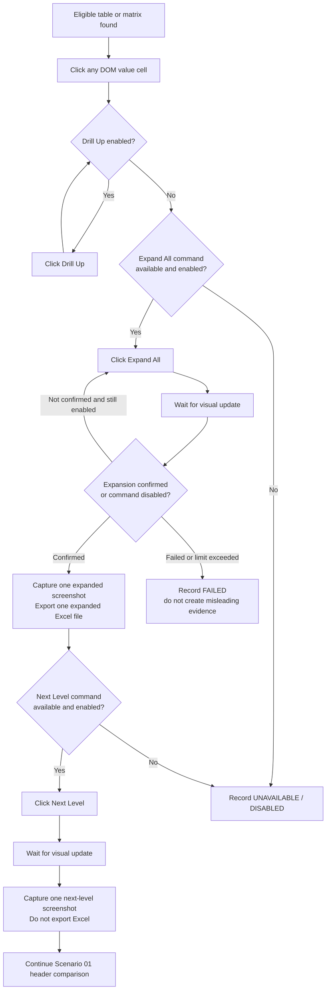

# Whole Project Architecture and Flowchart

## 1. Complete project architecture

```mermaid
flowchart TB
    U[User]

    subgraph CLIENT["CLIENT / PRESENTATION"]
        WEB[Web application<br/>Frontend/index.html]
        JS[Frontend controller<br/>Frontend/static/app.js]
        CSS[Styles<br/>Frontend/static/styles.css]
        CLI[Command line interface<br/>Backend/cli.py]
        WEB --- JS
        WEB --- CSS
    end

    subgraph API_LAYER["API AND JOB MANAGEMENT"]
        API[FastAPI application<br/>Backend/api.py]
        VALIDATE_INPUT[Validate job input<br/>max 10 jobs]
        JOB[Async job registry<br/>progress, errors, artifacts]
        STATUS[Status and download endpoints]
    end

    subgraph WORKFLOW_LAYER["WORKFLOW ORCHESTRATION"]
        WF[ADK SequentialAgent<br/>Backend/workflow.py]
        CAPTURE_STAGE[Capture]
        VALIDATE_STAGE[Validate]
        SCENARIO_STAGE[Functional scenarios]
        COMPARE_STAGE[Compare]
        REPORT_STAGE[Report]
        WF --> CAPTURE_STAGE --> VALIDATE_STAGE --> SCENARIO_STAGE --> COMPARE_STAGE --> REPORT_STAGE
    end

    subgraph DISCOVERY_LAYER["POWER BI DISCOVERY"]
        DISCOVERY[Backend/discovery.py]
        HOME[Power BI home]
        WORKSPACE[Exact workspace lookup]
        REPORT[Exact report lookup]
        URLS[Verified Dashboard A and B URLs]
        DISCOVERY --> HOME --> WORKSPACE --> REPORT --> URLS
    end

    subgraph BROWSER_LAYER["PLAYWRIGHT CAPTURE"]
        BROWSER[Backend/browser.py]
        CONTEXT[Authenticated browser context]
        PAGES[Report pages and tabs]
        READY[Render readiness and stability]
        DOM[DOM and accessibility inventory]
        FILTER_PLAN[Filter inventory and state plan]
        FILTER_RUN[Filter selection and restore]
        VISUALS[Visual candidates and geometry]
        SHOTS[Screenshots]
        EXPORT[Power BI visual exports]
        BROWSER --> CONTEXT --> PAGES --> READY --> DOM
        DOM --> FILTER_PLAN --> FILTER_RUN
        DOM --> VISUALS
        READY --> SHOTS
        VISUALS --> SHOTS
        VISUALS --> EXPORT
    end

    subgraph AI_LAYER["AI EVIDENCE ENRICHMENT"]
        AGENTS[Backend/agents.py]
        NORMALIZE[Normalize screenshot]
        GEMINI[Gemini / Vertex AI]
        PARSE[Parse and validate structured result]
        RETRY[Retry transient failure or truncation]
        AGENTS --> NORMALIZE --> GEMINI --> PARSE
        PARSE -. invalid or truncated .-> RETRY --> GEMINI
    end

    subgraph SCENARIO_LAYER["FUNCTIONAL VALIDATION"]
        SCENARIOS[Backend/validation_scenarios.py]
        S01[Scenario 01<br/>Table/header + hierarchy]
        S02[Scenario 02<br/>Single filter]
        S03[Scenario 03<br/>Multiple filters]
        HIERARCHY[Scenario 01 hierarchy sequence]
        ACTIVATE[Click DOM value cell]
        DRILLUP[Drill Up until disabled]
        EXPAND[Expand All until confirmed]
        EXPAND_EVIDENCE[One screenshot + one Excel export]
        NEXT[Go to Next Level]
        NEXT_EVIDENCE[One screenshot only]
        S01 --> HIERARCHY --> ACTIVATE --> DRILLUP --> EXPAND --> EXPAND_EVIDENCE --> NEXT --> NEXT_EVIDENCE
        SCENARIOS --> S01
        SCENARIOS --> S02
        SCENARIOS --> S03
    end

    subgraph COMPARISON_LAYER["DETERMINISTIC COMPARISON"]
        COMP[Backend/comparison.py]
        ALIGN[Align pages, filters, and visual states]
        STATUS[Assign PASS / FAIL / UNVERIFIED]
        VF[Backend/visual_filter_comparison.py]
        VI[Backend/visual_inventory_report.py]
        VFR[Backend/visual_filter_report.py]
        COMP --> ALIGN --> STATUS
        ALIGN --> VF
        ALIGN --> VI
        ALIGN --> VFR
    end

    subgraph SCENARIO_REPORTING["SCENARIO EVIDENCE AND COMPARISON"]
        EVIDENCE[Backend/scenario_evidence.py]
        MANIFEST[Evidence manifests and pairing keys]
        SCENARIO_COMPARE[Backend/scenario_comparison.py]
        EVIDENCE --> MANIFEST --> SCENARIO_COMPARE
    end

    subgraph REPORT_LAYER["REPORT GENERATION"]
        JSON_HELPER[Backend/json_evidence.py]
        DOCX[Backend/docx_report.py]
        XLSX[Excel workbook writer]
        JSON[JSON reports]
        WORD[DOCX reports]
        BOOK[Excel reports]
        JSON_HELPER --> JSON
        DOCX --> WORD
        XLSX --> BOOK
    end

    subgraph OUTPUT_LAYER["JOB OUTPUT"]
        OUTPUT[output/jobs/{job_id}/]
        IMAGES[Dashboard and scenario screenshots]
        HIERARCHY_FILES[Hierarchy Excel evidence]
        TIMING[operation_timings.jsonl]
        PERFORMANCE[capture_performance.jsonl]
        OUTPUT --> IMAGES
        OUTPUT --> HIERARCHY_FILES
        OUTPUT --> TIMING
        OUTPUT --> PERFORMANCE
    end

    subgraph EXTERNAL["EXTERNAL SYSTEMS"]
        BASE[Dashboard A<br/>Snowflake / Base Power BI]
        GCP[Dashboard B<br/>GCP / Compare Power BI]
        ADC[Google Cloud ADC]
        STORAGE[Playwright auth storage state]
    end

    U --> WEB
    U --> CLI
    WEB --> JS --> API
    CLI --> API
    API --> VALIDATE_INPUT --> JOB
    JOB --> STATUS
    JOB --> WF
    STATUS --> WEB

    CAPTURE_STAGE --> DISCOVERY
    CAPTURE_STAGE --> BROWSER
    DISCOVERY --> URLS --> BROWSER
    URLS --> BASE
    URLS --> GCP
    STORAGE --> CONTEXT

    SHOTS --> AGENTS
    DOM --> AGENTS
    AGENTS --> COMP
    SHOTS --> COMP
    EXPORT --> COMP

    VALIDATE_STAGE --> COMP
    SCENARIO_STAGE --> SCENARIOS
    SCENARIOS --> EVIDENCE
    EXPAND_EVIDENCE --> EVIDENCE
    NEXT_EVIDENCE --> EVIDENCE
    EVIDENCE --> SCENARIO_COMPARE
    SCENARIO_COMPARE --> STATUS

    COMPARE_STAGE --> COMP
    REPORT_STAGE --> JSON_HELPER
    REPORT_STAGE --> DOCX
    REPORT_STAGE --> XLSX
    STATUS --> JSON_HELPER
    STATUS --> DOCX
    STATUS --> XLSX
    VFR --> XLSX
    VI --> XLSX
    JSON --> OUTPUT
    WORD --> OUTPUT
    BOOK --> OUTPUT
    SHOTS --> IMAGES
    EXPORT --> HIERARCHY_FILES
    WF --> TIMING
    BROWSER --> PERFORMANCE
    OUTPUT --> STATUS

    GEMINI -. authenticated project .-> ADC

    classDef layer fill:#eef5fb,stroke:#4779a8,color:#102a43;
    classDef external fill:#fff5e3,stroke:#c58a2b,color:#4a2c00;
    classDef output fill:#eaf8ef,stroke:#4a9b69,color:#164a2b;
    classDef critical fill:#e9f0ff,stroke:#315b9b,color:#102a43;

    class WEB,JS,CSS,CLI,API,VALIDATE_INPUT,JOB,STATUS,WF,CAPTURE_STAGE,VALIDATE_STAGE,SCENARIO_STAGE,COMPARE_STAGE,REPORT_STAGE,DISCOVERY,HOME,WORKSPACE,REPORT,URLS,BROWSER,CONTEXT,PAGES,READY,DOM,FILTER_PLAN,FILTER_RUN,VISUALS,SHOTS,EXPORT,AGENTS,NORMALIZE,GEMINI,PARSE,RETRY,SCENARIOS,S01,S02,S03,HIERARCHY,ACTIVATE,DRILLUP,EXPAND,EXPAND_EVIDENCE,NEXT,NEXT_EVIDENCE,COMP,ALIGN,VF,VI,VFR,EVIDENCE,MANIFEST,SCENARIO_COMPARE,JSON_HELPER,DOCX,XLSX layer;
    class BASE,GCP,ADC,STORAGE external;
    class JSON,WORD,BOOK,OUTPUT,IMAGES,HIERARCHY_FILES,TIMING,PERFORMANCE output;
    class HIERARCHY,EXPAND_EVIDENCE,NEXT_EVIDENCE,STATUS critical;
```

## 2. End-to-end execution flow

```mermaid
flowchart LR
    A[Enter workspace/report<br/>or dashboard URLs]
    B[Validate input]
    C[Create job ID<br/>output/jobs/{job_id}]
    D[Discover exact Power BI reports]
    E[Open authenticated pages]
    F[Wait for render readiness]
    G[Inventory pages, filters,<br/>visuals and geometry]
    H[Plan initial/filter states]
    I[Capture Dashboard A and B]
    J[Gemini visual extraction]
    K[Validate captured states]
    L[Run functional scenarios]
    M[Align Base and Compare states]
    N[Assign comparison status]
    O[Write JSON, Excel and DOCX]
    P[Return progress and downloads]

    A --> B --> C --> D --> E --> F --> G --> H --> I --> J --> K --> L --> M --> N --> O --> P
```

## 3. Scenario 01 hierarchy flow



## 4. Important project rules

| Area | Rule |
|---|---|
| Dashboard roles | Dashboard A is Base/Snowflake; Dashboard B is Compare/GCP |
| Rendering | Unrendered visuals are not silently accepted as successful |
| AI | Gemini enriches evidence; Python owns final comparison status |
| Scenario ownership | Scenario 01 owns table/matrix hierarchy execution |
| Drill sequence | Activate value cell → Drill Up → Expand All → Next Level |
| Step 3 evidence | One screenshot and one Excel export after confirmed expansion |
| Step 4 evidence | One screenshot only; no Excel export |
| Interaction | Use DOM controls; do not use header scrolling for hierarchy |
| Failure handling | Missing, disabled, or failed commands are recorded explicitly |
| Security | Authenticated storage state and credentials stay outside source control |

## 5. Main source files

- [Backend/api.py](./Backend/api.py) — API, jobs, progress, downloads
- [Backend/workflow.py](./Backend/workflow.py) — sequential workflow
- [Backend/discovery.py](./Backend/discovery.py) — Power BI discovery
- [Backend/browser.py](./Backend/browser.py) — browser capture and exports
- [Backend/agents.py](./Backend/agents.py) — Gemini extraction
- [Backend/validation_scenarios.py](./Backend/validation_scenarios.py) —
  functional scenarios and hierarchy workflow
- [Backend/comparison.py](./Backend/comparison.py) — deterministic comparison
- [Backend/scenario_evidence.py](./Backend/scenario_evidence.py) — evidence
  organization and manifests
- [Backend/scenario_comparison.py](./Backend/scenario_comparison.py) —
  scenario evidence comparison
- [Backend/docx_report.py](./Backend/docx_report.py) — DOCX output
- [Backend/visual_filter_report.py](./Backend/visual_filter_report.py) —
  visual/filter workbook data
- [Frontend/index.html](./Frontend/index.html) — web UI
